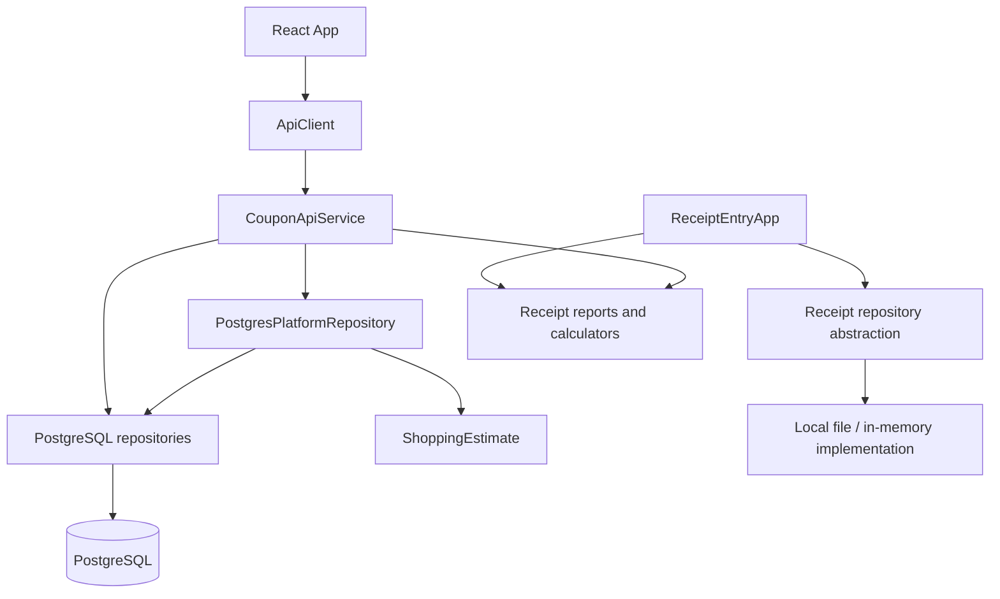

# System overview and feature ownership

## Revision history

| Version | Date | Changes | Verification |
|---|---|---|---|
| 1.0 | 2026-10-21 | Original reference snapshot | Static inspection |
| 1.1 | 2026-10-22 | Planning reward progress, unknown-value semantics and current UPC policy | Source updated; final checks not run |
| 1.2 | 2026-10-22 | Receipt evidence/reconciliation, distinct purchase/scan and partial benefit values | See VERIFICATION.md |

## Revision 1.2 — receipt evidence and reconciliation

ReceiptInput → ReceiptMeta/worksheet role observations → TransactionCalculator.reconcilePayments → PostgresPlatformRepository.totals → shared ReceiptFinancialReview in ReceiptCreate/ReceiptDetail. Existing receipt save checks use basis-aware acknowledgment; old unknown-basis requests retain legacy behavior. No shopping-plan conversion/draft/deletion features are included.

## Revision 1.1 — current behavior and status

Planning response path now includes ShoppingEstimate.DealProgress → existing record JSON codec → platform.ts → WorkspacePages.PlanCard and CheckoutForm. PostgresPlanCheckoutRepository forwards derived reward completeness/review without posting financial events. Existing editors are reused. No new application files or migrations. Source implementation and documentation have changed; final sanity checks have not run.

Original revision 1.0 inspection: October 21, 2026 (America/Chicago). Base Git commit: `fa3b8debc070cb5de990cbe9eb420fe1e56b7c06`. This reference describes the working tree, including pre-existing uncommitted checkout changes; it does not prove what is deployed online. No application tests were run for this documentation-only task.

## Application paths

The diagram shows ownership rather than every invocation. Follow imports and repository construction in source to determine a particular runtime path.

| Area | Main sources | Responsibility |
|---|---|---|
| Interactive receipt CLI | ReceiptEntryApp.java | Guided entry, tax, payments, reward observations, corrections and review |
| Demo entry | CouponTrackerApp.java → CouponSystem.run() | Demonstration transaction and distributed example; not the full interactive receipt workflow |
| API process | api/CouponApiServer.java | Environment-based PostgreSQL and HTTP service construction |
| Browser shell | frontend/src/App.tsx | Connection, workspace refresh, navigation and dialogs |
| Browser pages | frontend/src/pages/WorkspacePages.tsx | Overview, plans, receipts, deals, accounts, inventory and rebate presentation |
| Receipt creation/reward editing | frontend/src/features/receipts/ | Receipt preview/save, reward programs, associations and lifecycle forms |
| Shopping plans | frontend/src/features/shopping/ | Planned items, deals, coupons and checkout inputs |
| Domain arithmetic | ShoppingEstimate, TransactionCalculator, QualifyingSpend, PromotionQualification | Estimates versus actual receipt calculations |
| Reports/account views | ReceiptReport, ReceiptWorksheetReport, SavingsReport, ProviderBalanceSummary | Presentation and derived financial/account views |
| Persistence | repository/ | Local state, PostgreSQL storage, snapshots, history, inventory and provider accounts |
| Imports | ReceiptImportReader, ReceiptImportDraft, WalgreensImageImport, LocalReceiptOcr | Import parsing and review; imported observations are not automatic proof of eligibility |
| Local-to-PostgreSQL migration | LocalMigrationSource, LocalMigrationPreview, LocalToPostgresMigration | Separate migration workflow; not the normal act of saving a plan |
| Distributed demonstration | DistributedProcess, DistributedEvent and related classes | Educational/distributed event examples; inspect individual classes before treating as production synchronization |

## Important boundaries

A planned purchase is not a receipt line. An advertised deal is not a received reward. A checkout estimate is not an account credit. A gift-card promotion tracked across receipts is a different model from one shopping-plan deal. These concepts share labels in the UI but must not be silently interchanged.

Java uses BigDecimal for money. The browser client uses lossless-json and preserves numeric lexemes as strings; UI types therefore use decimal/string contracts. ApiClient supplies bearer authorization, disables API caching and attaches idempotency/revision headers for writes.

Local CLI file persistence uses locking and serialized snapshots. The API is constructed with PostgreSQL repositories. Working in one storage path does not establish that records were transferred to the other.

## Existing documentation

Continue using ../design/API.md, ../requirements/DOMAIN_VOCABULARY.md and ../operations/ for existing design and operational guidance. Archive documents and receipt images remain evidence/history; they are not guaranteed current specifications. See FILE-CATALOG.md for links to individual files.

## Frontend design system — October 23, 2026

Visual design is specified in [FRONTEND-DESIGN-SYSTEM.md](FRONTEND-DESIGN-SYSTEM.md).
Named tokens in frontend/src/index.css feed index.css global control rules;
App.css owns grids and a 680px dialog-container breakpoint. AutoSizeTextArea wraps
and expands product/discount descriptions. Forms use 48px single-line controls and
16px value text. The SRS owns usability requirements; SDD 5.2 owns the architecture
and points to the style guide. No financial or API semantics changed.

October 23 sizing increase: controls enlarged from 48px to 60px and value fonts
from 16px to 18px. Modal/filter labels are 15px; horizontal control padding is
16px. Dialog maximum width is 1040px. Receipt editor/product fields are full-width
single-column even on desktop. Long descriptions expand. Current specification:
docs/reference/FRONTEND-DESIGN-SYSTEM.md; executable values:
frontend/src/index.css. SRS/SDD internal revision 1.5 supersedes 1.4 sizing.

## Revision 1.6 — receipt and reward account workflow

The Rewards balance list opens a provider detail view with an explicit date range, confirmed/carried-forward beginning, recorded earnings/spending, ending and native points. Java AccountActivityView projects existing movements and RR associations; PostgresPlatformRepository serves account ranges. Receipt forms use shared optional printed-footer controls and clearer payment-completeness wording. Source observations remain separate from financial calculations. See [complete workflow and changed-file map](RECEIPT-REWARDS-WORKFLOWS.md).

## Revision 1.7 — receipt RR correction and matching

RR use can be recorded and corrected in Edit receipt, separately from payments/coupons, then matched on the saved receipt’s Rewards or Totals section. ReceiptRRMatching supplies only eligible source options; PostgresReceiptSupplementRepository matches under the shared state lock and receipt revision check. Other payment roles can be resolved explicitly. Printed footer values are below payments and collapsible; used-reward details are last. See RECEIPT-REWARDS-WORKFLOWS.md for the two-stage record/save, then source-match workflow.

## Revision 1.8 — RR without an earning receipt

Add RR without an earning receipt lets the owner record a standalone source coupon and match an already recorded RR use in one operation. Earning receipt, earned date and expiration may remain unknown. Amount comes from the existing use; no earning, payment, receipt or second deduction is created. A source note and confirmation that the coupon was used are required. Known conflicting dates, stale revisions and already matched uses are rejected. Both instrument and link persist under the shared receipt-state lock in one transaction with the existing API retry journal.

## Revision 1.9 — Rewards points-account display

On the Rewards pages, only MyPoints, Fetch, P&G Brand (PGBRAND), Swagbucks (SWAGBUCK) and Merryfield show points information. Other account detail pages hide native-point balances, activity columns, point-valuation text, converted point quantities and the Original Points opening field, even if older records contain native units. Non-points opening forms use Balance Basis and require a dollar amount; new requests send points:null. The mixed account list shows a points column only when an allowed account is listed, with a dash for other accounts. This is Rewards presentation policy; receipt/CLI behavior, stored units and Java financial calculations remain intact.

## Revision 1.10 — independent Rewards inventory

The Rewards overview and Register Rewards detail page expose Add reward without a receipt. The owner can save an unused standalone Register Reward by description and positive amount, with optional earned/expiration dates and no receipt of any kind required. A coupon inventory table shows UNUSED, MATCHED or REDEEMED status. Saving inventory does not add a receipt earning, account credit, payment, deduction or immediate match. Later, an equal-value recorded receipt use can select that coupon. Standalone coupons with unknown earning date/time are offered with historyUnknown=true and require explicit confirmation they were available for that purchase; known future/expired/consumed sources remain excluded. Matched sources remain reserved.

## Revision 1.11 — visible recorded receipt calculations

Receipt totals now show arithmetic from recorded entries even when historical printed-total basis or payment completeness is unknown. Unknown basis displays both before-funding and after-reward-use calculated totals, purchase differences, funding subtotals and payment differences. A known basis displays its scenario. Incomplete/unknown entry or unresolved roles are explicitly Provisional — recorded entries only. Zero arithmetic difference does not prove complete payment entry. Existing metadata, strict reconciliation status/differences, Actual OOP, benefit-adjusted spending rules, legacy figures and history are preserved; no receipts are automatically marked complete or verified.

## Revision 1.12 — simplified receipt totals display

Per user request, receipt totals/review no longer displays Calculated total on recorded basis, its before/after-reward alternatives, or the Receipt calculation checks table. Saved printed observations also hide Store Coupon Savings. Store coupon input remains available in Add/Edit Receipt; existing saved observations, API calculationChecks, Java formulas, strict validation, Actual OOP, Total Saved, legacy details and history remain unchanged. This supersedes revision 1.11 UI visibility only.

## Revision 1.13 — reuse existing files and align CLI rebate display

Current ownership: receipt create/review/shared printed fields and item discounts → ReceiptCreate.tsx; receipt editing/status/matching → ReceiptDetail.tsx; Rewards/account/standalone inventory and reward connection → WorkspacePages.tsx; browse/date/search helpers → api/format.ts; printed draft helpers → rewardStatus.ts; expanding textarea → components/ui.tsx; font/color/size tokens → index.css. AccountActivityView is nested in ProviderBalanceSummary.java; ReceiptRRMatching is nested in PostgresPlatformRepository.java; package-private correction/footer parsers share ReceiptInput.java. All earlier helper test cases remain in existing receipt/calculator/provider/repository test files.

The visible receipt measure is Total Paid after rebates, sourced directly from savings.paidAfterRebates — the same SavingsReport value used by the CLI. Formula: recorded cash/card minus newly earned reward/rebate dollars, including saved USD point valuations. The frontend no longer uses the stricter benefitAdjustedCashSpending field for this spreadsheet measure; that compatibility field and its explicit-completeness semantics remain unchanged. Unknown historical payment-entry metadata alone does not hide the CLI value. Truly missing tender or dollar valuations still leave the CLI measure unknown, now explained as Cannot calculate yet. Actual OOP, reward use, Total Saved and stored facts are unchanged.

### Optional RR matching note

The receipt RR matching form accepts an optional matching note. Selecting an eligible reward is sufficient; unknown-history availability confirmation is still required when applicable. POST `/receipts/{id}/rr-matches` accepts an omitted, null, empty or whitespace-only `reason`; the server records the neutral audit description “Matched recorded RR use to selected reward” when no note is supplied. A supplied note is retained after trimming. This does not create another reward or deduction. Existing receipt correction/deletion reasons and unknown-source confirmation rules are unchanged. Implementation: `frontend/src/features/receipts/ReceiptDetail.tsx`, `src/main/java/coupons/api/CouponApiService.java`; regression: existing `ReceiptCreate.test.tsx`.

### Receipt period reporting update — October 23, 2026

Receipts → Period totals displays Regular price including tax, Actual OOP, Total amount saved, Confirmed benefits, Total Paid after rebates, and Total % saved. Pending rebates are not shown or included. Existing Java CLI savings rules and saved points valuations apply; original receipt data and valuations are unchanged. Cash/card Actual OOP excludes rewards used and gift cards. Percent saved uses regular merchandise plus recorded tax as denominator; a zero/unknown denominator remains Not recorded. Unknown inputs retain existing null/completeness behavior.

Select Purchase day or Month, enter inclusive Start date and End date, or click Month to date (the current local calendar month through today). Selecting a day/month clears the range; entering a range clears day/month. Clear filters returns to All time. Totals cover all active latest receipt revisions across every page, regardless of text search or status filter. Search continues across dates/statuses; without search the receipt list follows the selected period. Date-range loading/errors never reuse the prior summary. Invalid or incomplete ranges require correction.

Read-only authenticated API: GET /receipts/summary?from=YYYY-MM-DD&to=YYYY-MM-DD returns the existing Savings shape. Both dates are required, start must not exceed end, and undated/deleted receipts are excluded. Range calculation runs in Java through SavingsReport.range and the existing savings projection; the browser performs no money aggregation. No database schema change.

Existing implementation files changed: src/main/java/coupons/SavingsReport.java; src/main/java/coupons/repository/PostgresPlatformRepository.java; src/main/java/coupons/api/CouponApiService.java; frontend/src/api/client.ts; frontend/src/pages/WorkspacePages.tsx. Existing regression files: src/test/java/coupons/SavingsReportTest.java; frontend/src/features/receipts/ReceiptCreate.test.tsx. No new files. Layout uses the existing centered three-column receipt-period-totals grid (six metrics in two rows), collapsing to one column on narrow screens; existing typography/control tokens remain unchanged.

### Receipt entry breakdown and field errors — October 23, 2026

Add Receipt now provides a Review entered breakdown button near the top, in addition to the existing calculated review action. The Java preview review lists product descriptions, regular prices, quantities, recorded extended prices and individual attached discounts; shared/receipt-wide discounts appear separately with their selected products. Existing tax, tender, reward-used, earned-benefit and savings calculations remain in the financial review. No additional browser money calculations or financial events are introduced.

Receipt-entry invalid fields receive a red border and pale red background, aria-invalid, and a descriptive error. Validation scrolls to and focuses the first invalid control; collapsed containing details are opened. Received reward confirmations explain the original unit, compare exact decimal strings without Number conversion, and show an inline error if the confirmed amount differs. Equivalent values such as 5 and 5.00 remain valid. Correct Reward amount first when the actual received amount differs. Points and their saved USD valuation remain separate. New-earning API validation identifies the offer/provider and expected amount/unit rather than displaying status-only workflow wording. Existing saved-reward status restrictions remain unchanged.

The draft information message is explanatory, not an error: the receipt is unsaved until review and Save receipt; closing discards unsaved input. It now says this in plain language. Existing files edited: frontend/src/features/receipts/ReceiptCreate.tsx; frontend/src/features/receipts/RewardFields.tsx; frontend/src/index.css; src/main/java/coupons/api/EarningInput.java. Existing regressions: ReceiptCreate.test.tsx and src/test/java/coupons/api/ReceiptInputTest.java. No new files or database-schema changes.

### Multiple Register Rewards used during receipt creation — October 23, 2026

Add Receipt → Register Rewards used now offers Add RR used and removable individual rows, each with one dollar amount and optional description. Enter $5, $5 and $4 as three separate coupons; duplicate dollar values remain distinct through stable event IDs. Blank descriptions default to Register Rewards used. The review shows each coupon and the Java-calculated RR total. These receipt-wide deductions must not be entered again as discounts or payment tenders. Existing post-save matching offers a separate source match for each use; matching does not create another deduction. Edit Receipt already supports separate RR uses and is unchanged.

Receipt preview/create accept rrUses:[{eventId,amount,recordedDescription?}] with at most 100 positive entries and unique event IDs. The legacy rrUsed/rrUsageId request remains supported; a nonzero legacy amount alongside rrUses is rejected to prevent double counting. Existing UnidentifiedRR observations store the separate uses; no schema/model migration or new financial formula is introduced. Preview tokens and stable save retries retain the individual IDs.

Existing files updated: frontend/src/features/receipts/ReceiptCreate.tsx; src/main/java/coupons/api/ReceiptInput.java; frontend/src/features/receipts/ReceiptCreate.test.tsx; src/test/java/coupons/api/ReceiptInputTest.java. No new files. Regression coverage verifies $5+$5+$4 yields $14, equal coupons have different IDs, preview/save preserve identities, and zero/duplicate-ID/mixed legacy input is rejected.

Receipt product lookup: existing active receipt history populates workspace.productLookup with SKU, description, most recent regular price, purchase date and source receipt. Latest revisions are deduplicated before filtering; deleted receipts are excluded. SKU leading zeros are preserved, and conflicting descriptions for one SKU remain separate selectable choices. Add Receipt suggests up to eight prefix matches as SKU is typed. Use this product fills description/SKU/last regular price and quantity 1; no historical promotions, coupons or rewards are copied. The user reviews the current price and discounts. This is a read-only product reference, not an import into on-hand inventory; historical purchases do not prove remaining stock. Existing PostgresPlatformRepository.java, types/platform.ts, App.tsx, ReceiptCreate.tsx, ReceiptCreate.test.tsx and SavingsReportTest.java updated. No new files or database tables.

### Receipt total detail reports — October 24, 2026

Receipts period totals Regular price including tax, Actual OOP, Total amount saved and Total Paid after rebates are clickable. Each opens an existing-style modal with all active records in the selected day/month/inclusive range or all time, independent of receipt-list search/status/page. Reports support item/SKU/store/receipt/date/time/payment-type text search and date/time newest/oldest, store A–Z and item/payment-type A–Z sorting. Receipt links open source details. Regular price shows individual product regular extended values plus separate sales-tax rows. OOP shows individual cash/card tenders with period cash/card totals and matching cash/card subtotals; WC/RR/gift cards are excluded. Saved/net views show one contribution per receipt with its product descriptions. Period total remains unchanged by report search; Matching subtotal follows visible rows. Unknown contributions remain unknown.

Read-only authenticated GET /receipts/report?metric=regular|oop|saved|net&from=&to=&search=&sort= returns metric, existing Savings summary, rows, matchedTotal, matchedCash and matchedCard. Bounds are inclusive and optional; latest active revisions only. All money multiplication/aggregation uses Java BigDecimal and existing SavingsReport rules; the browser formats exact decimal strings. This introduces no saved records, schema or formula changes.

Existing files updated: src/main/java/coupons/repository/PostgresPlatformRepository.java; src/main/java/coupons/api/CouponApiService.java; frontend/src/api/client.ts; frontend/src/types/platform.ts; frontend/src/pages/WorkspacePages.tsx; frontend/src/App.css; src/test/java/coupons/SavingsReportTest.java; frontend/src/features/receipts/ReceiptCreate.test.tsx. No new files.

Rewards Overview (approved definition): Total Rewards = Available Balances + Expected / Unconfirmed, shown separately on the Rewards main page for Balance through. Available sums positive recorded account closing balances after recorded spending/transfers; confirmed earnings are not added again. Expected includes outstanding active-receipt rewards dated on/before the selected day, excluding received, rejected and expired expected entries. Prior-month outstanding rewards remain included. Native points use saved/automatic USD valuations. Missing balance/valuation leaves the affected full total unknown and shows known subtotals/providers for review. Account search does not change these overview totals. GET /workspace adds rewardsOverview with available, expected, total, known subtotals and completeness context. Existing PostgresPlatformRepository.java, types/platform.ts, WorkspacePages.tsx and SavingsReportTest.java updated; no new files or personal record changes.

Clipped coupons and catalog cleanup: Deals & promotions and Coupons now expose permanent Delete actions with write access and revision checks. DELETE /deals/{id} and DELETE /clipped-coupons/{id} remove the catalog record and its own revision history, detach current plan associations while retaining product prices, and remove deal source artifacts only when not shared. Normal plan revision history remains; no deletion backup is created. Redeemed coupons cannot be deleted. Receipt entry accepts clippedCouponIds and offers saved coupon selection per product and in shared/receipt-wide discounts. Selection creates one editable discount with the coupon UUID, description, type and buy requirement; use the shared selector for a coupon covering several products. Percentage/free-item deductions use the actual recorded receipt amount. Selecting does not consume a coupon; receipt creation and all selected coupon redemptions commit atomically in PostgreSQL. Expired, already-used, or ineligible coupons cause rollback. The Coupons page then shows Applied and the receipt connection. Do not manually repeat a selected deduction. Existing receipt corrections retain their separate workflow; editing a discount does not automatically release a previously redeemed coupon. No new schema migration or files are introduced.

Changed application and test files: frontend/src/App.tsx, frontend/src/pages/WorkspacePages.tsx, frontend/src/features/receipts/ReceiptCreate.tsx, frontend/src/types/platform.ts, frontend/src/App.css, frontend/src/features/receipts/ReceiptCreate.test.tsx, src/main/java/coupons/api/CouponApiService.java, src/main/java/coupons/api/ReceiptInput.java, src/main/java/coupons/repository/PostgresPlatformRepository.java, src/main/java/coupons/repository/PostgresTransactionRepository.java, src/main/java/coupons/repository/PostgresClippedCouponRepository.java, src/test/java/coupons/repository/PostgresTransactionRepositoryTest.java.
